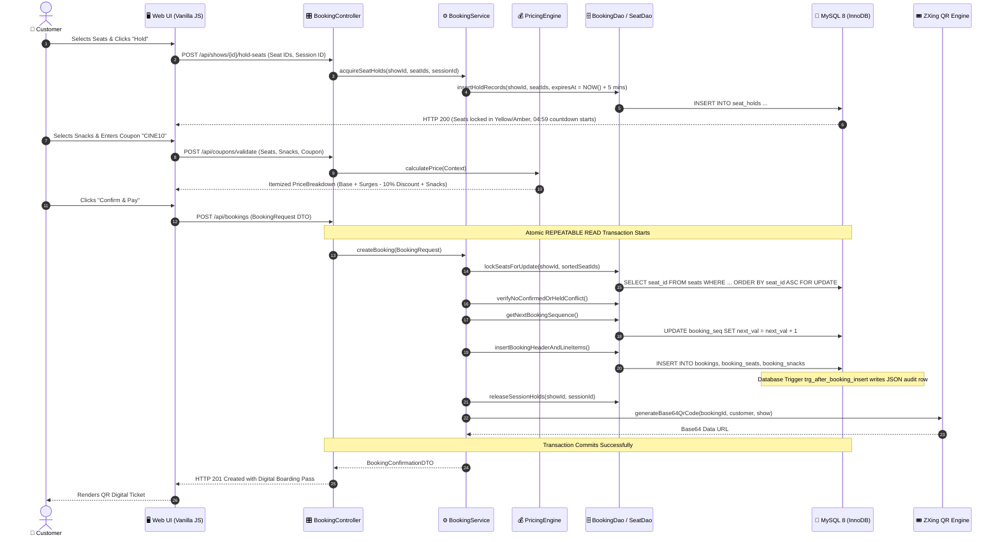
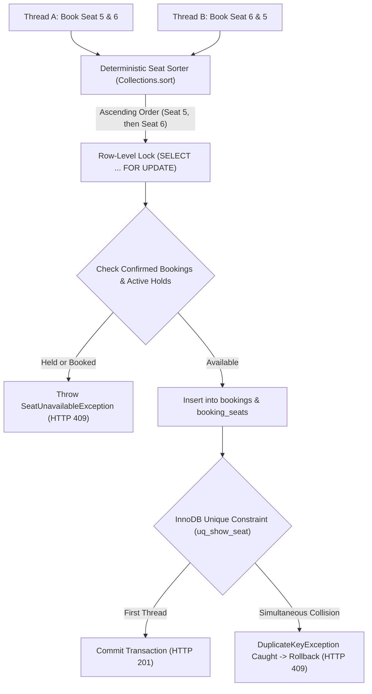

# 🏛️ CineBook Web — Comprehensive System Architecture

> **Executive System Architecture Document for Project Presentation & Technical Defense**  
> *Developed for 2nd-Year B.E. Computer Science & Engineering (OOP using Java + Database Management Systems)*

---

## 1. High-Level Project Overview & Presentation Pitch

**CineBook Web** is an enterprise-grade cinema reservation and concessions web application engineered to solve real-world transaction management, race conditions, and dynamic pricing challenges.

Unlike typical monolithic student CRUD apps, CineBook Web implements:
- **Clean Layered Separation of Concerns**: Strict boundary separation across Presentation, REST Controllers, Service/Domain Logic, Data Access (DAO), and Relational Database engine.
- **Explicit Zero-ORM Architecture**: Eliminates Hibernate/JPA black-box magic in favor of pure **Spring `JdbcTemplate`** and the **DAO Pattern**, enabling explicit row-level locking (`SELECT ... FOR UPDATE`), deterministic deadlock prevention, and manual transaction boundaries (`REPEATABLE READ`).
- **Production Dual-Engine Coordination**: Application-level background schedulers work concurrently with database-level MySQL 8 events, stored procedures, audit triggers, and window functions.
- **Curated Multi-Genre Catalog & Theatrical Posters**: Real-world cinema catalog featuring 6 major titles (*Hi Nanna*, *Dear Comrade*, *Avengers: Endgame*, *Spider-Man: Brand New Day*, *Jananayagan*, *Sita Ramam*) with dynamic show schedules and automated startup synchronization (`MovieDataInitializer`).
- **Interactive Admin Operations Suite**: Master-detail screening inspector, 2D interactive auditorium seat map, and real-time customer reservation roster.
- **Cloud-Native Deployment**: Containerized multi-stage Docker build running live on **Render** backed by an **Aiven Cloud MySQL 8.0** cluster.

---

## 2. Multi-Tier Layered Architecture

CineBook Web follows an industry-standard 5-tier architectural model:

```
+---------------------------------------------------------------------------------------+
| 1. PRESENTATION LAYER (Client-Side Single Page & Static Web Assets)                  |
|    - HTML5, Modern CSS3 Cinema Dark Theme, Vanilla ES6+ JavaScript, Chart.js         |
|    - index.html (Showtimes) | seat-selection.html (Grid & Hold) | checkout.html (Pay) |
|    - my-tickets.html (Lookup & 80% Refund) | admin.html (Executive KPI Dashboard)     |
+---------------------------------------------------------------------------------------+
                                            │ HTTP / REST (JSON)
                                            ▼
+---------------------------------------------------------------------------------------+
| 2. API & CONTROLLER LAYER (Spring Boot 3 Web MVC @RestController)                    |
|    - MovieController, ShowController, BookingController, AdminController              |
|    - Bean Validation (Jakarta Validation: @NotNull, @NotBlank, @Min)                 |
|    - GlobalExceptionHandler (@RestControllerAdvice) -> Uniform ApiResponse<T> Envelopes|
+---------------------------------------------------------------------------------------+
                                            │ DTOs & Command Objects
                                            ▼
+---------------------------------------------------------------------------------------+
| 3. BUSINESS LOGIC & SERVICE LAYER (@Service & @Transactional)                         |
|    - BookingService (Atomic reservation orchestration & 80% cancellation refunds)    |
|    - PricingEngine (Decorator/Chain of Responsibility dynamic fee calculation)        |
|    - SeatHoldService (5-minute TTL locks with background Spring scheduler)           |
|    - RecommendationService (Strategy Pattern: Center vs Tier-Optimized algorithms)   |
|    - ZxingQrCodeService (Cryptographic Base64 PNG boarding passes)                   |
+---------------------------------------------------------------------------------------+
                                            │ Domain Entities / Value Objects
                                            ▼
+---------------------------------------------------------------------------------------+
| 4. DATA ACCESS LAYER (DAO Pattern via Spring JdbcTemplate - Explicitly NO ORM)       |
|    - MovieDao, ShowDao, SeatDao, BookingDao, SnackDao, AnalyticsDao                   |
|    - RowMapper<T> implementations for deterministic database-to-object mapping       |
|    - HikariCP Connection Pool (Max: 15, Idle: 5, Connection Timeout: 20s)             |
+---------------------------------------------------------------------------------------+
                                            │ Parameterized SQL, Row Locks, Views, Procs
                                            ▼
+---------------------------------------------------------------------------------------+
| 5. PERSISTENCE LAYER (MySQL 8.0 InnoDB Database Engine)                               |
|    - 15 Normalized Tables (3NF) with Foreign Key constraints (CASCADE / RESTRICT)     |
|    - Deterministic Row-Level Locks (SELECT ... FOR UPDATE) & Unique Constraints      |
|    - Stored Procedures (sp_release_expired_holds, sp_cancel_booking)                  |
|    - Analytical Views with Window Functions (v_top_selling_snacks with DENSE_RANK())  |
|    - Real-time Audit Triggers (trg_after_booking_insert, trg_after_booking_cancel)   |
|    - MySQL Scheduled Event (evt_clean_expired_seat_holds runs every 60s)             |
+---------------------------------------------------------------------------------------+
```

---

## 3. End-to-End Data Flow & Sequence Diagram

The following diagram illustrates the transactional reservation lifecycle from seat selection to QR digital pass generation:



---

## 4. Concurrency & Collision-Prevention Architecture

A major challenge in high-demand cinema ticketing is preventing **Double-Booking** and **Deadlocks**. CineBook Web deploys a multi-layered defensive strategy:



### Why Deadlocks are Mathematically Impossible:
- **Coffman Condition #4 (Circular Wait)** is eliminated by sorting seat identifiers ascending (`Collections.sort(seatIds)`). 
- Every concurrent thread requests lock on `Seat 5` before requesting `Seat 6`. Thus, no two threads can hold one seat while waiting on each other.

---

## 5. REST API Architecture Summary

All endpoints return uniform JSON envelopes (`ApiResponse<T>`):

| Domain | Method & Path | Description |
|---|---|---|
| **Movies** | `GET /api/movies` | Fetches active movie catalog with posters and runtimes |
| **Showtimes** | `GET /api/movies/{id}/shows` | Screenings partitioned by screen with dynamic base multipliers |
| **All Shows** | `GET /api/shows` | Returns all upcoming scheduled screenings |
| **Seat Map** | `GET /api/shows/{id}/seats` | Real-time seat grid (`AVAILABLE`, `HELD`, `HELD_BY_YOU`, `BOOKED`) |
| **Seat Hold** | `POST /api/shows/{id}/hold-seats` | Acquires 5-minute exclusive hold lock on seat array |
| **Recommendation** | `POST /api/shows/{id}/recommend-seats`| Executes Strategy Pattern to find contiguous optimal seats |
| **Pricing** | `POST /api/coupons/validate` | Evaluates dynamic pricing engine and coupon application |
| **Bookings** | `POST /api/bookings` | Executes transactional reservation and returns ZXing QR pass |
| **Lookup** | `GET /api/bookings/{id}` | Boarding pass retrieval by Booking ID, Phone, or Email |
| **Cancellation** | `POST /api/bookings/{id}/cancel` | Invokes stored procedure `sp_cancel_booking` for 80% refund |
| **Admin Shows** | `GET /api/admin/shows` | Returns all upcoming shows with real-time occupancy and movie metadata |
| **Booked Seats** | `GET /api/admin/shows/{id}/booked-seats` | Returns confirmed booked seats with customer names, contacts, and ticket IDs |
| **Analytics** | `GET /api/admin/analytics` | Returns real-time KPI metrics and Chart.js aggregation data |

---

## 6. Production Cloud & Deployment Topography

CineBook Web operates in a production-ready containerized environment:

```
[ Internet / Browser Clients ]
               │
               ▼ (HTTPS / TLS 1.3)
[ Render.com Web Service Cloud ]
   └── Docker Container (Eclipse Temurin JRE 21 on Ubuntu Jammy)
       ├── Spring Boot 3.3.4 Application Port: $PORT (8080)
       ├── HikariCP Connection Pool (15 connections)
       └── Static Resource Server (HTML5/CSS3/ES6 Client)
               │
               ▼ (Secure TLS Connection / Port: 23798)
[ Aiven.io Cloud Managed MySQL 8.0 Cluster ]
   ├── Database: cinebook_web
   ├── InnoDB Storage Engine with B+Tree Indexes
   ├── Stored Procedures & Triggers (log_bin_trust_function_creators=1)
   └── Automated Scheduled Event Daemon
```
