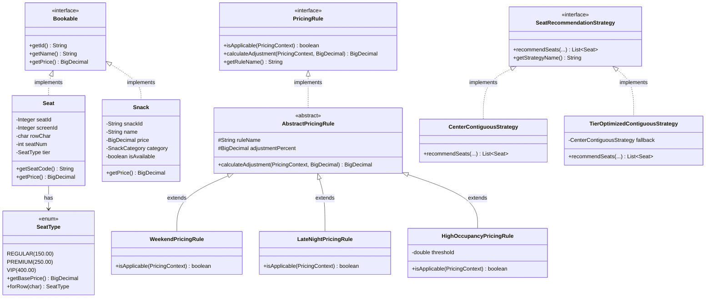

# CineBook Web — System Architecture & OOP Design

## 1. Multi-Tier Layered Architecture

```
+-------------------------------------------------------------------------+
|                  Client Layer (Vanilla HTML5 / CSS3 / ES6)             |
|   index.html   seat-selection.html   snacks.html   checkout.html ...    |
+-------------------------------------------------------------------------+
                                    | (REST / JSON)
                                    v
+-------------------------------------------------------------------------+
|               Controller Layer (Spring Web @RestController)             |
|   MovieController, ShowController, BookingController, AdminController  |
+-------------------------------------------------------------------------+
                                    | (DTOs)
                                    v
+-------------------------------------------------------------------------+
|                Service Layer (Business Logic & @Transactional)           |
|   BookingService, PricingEngine, SeatHoldService, RecommendationService |
+-------------------------------------------------------------------------+
                                    | (Domain Entities)
                                    v
+-------------------------------------------------------------------------+
|                    Data Access Layer (DAO Pattern)                      |
|       MovieDao, ShowDao, SeatDao, BookingDao, SnackDao, AnalyticsDao     |
|             (Plain JDBC via Spring JdbcTemplate - Explicitly No ORM)     |
+-------------------------------------------------------------------------+
                                    | (Raw SQL, Locks, Views, Procs)
                                    v
+-------------------------------------------------------------------------+
|                         Database Layer (MySQL 8)                        |
|       InnoDB Tables, Stored Procedures, Views, Triggers, Events         |
+-------------------------------------------------------------------------+
```

---

## 2. OOP Class Hierarchy (Mermaid)



---

## 3. Design Patterns Applied

1. **DAO (Data Access Object) Pattern**:
   - Interfaces (`MovieDao`, `ShowDao`, `BookingDao`, `SeatDao`, `SnackDao`) abstract persistence operations away from business services.
   - Plain JDBC with `JdbcTemplate` ensures raw SQL tuning, manual transaction control, and deterministic `SELECT ... FOR UPDATE` row locks.

2. **Strategy Pattern**:
   - `SeatRecommendationStrategy`: Pluggable seat selection algorithms (`CenterContiguousStrategy` vs `TierOptimizedContiguousStrategy`).
   - `PricingRule`: Dynamic pricing adjustments evaluated polymorphically based on screening parameters.

3. **Decorator / Chain of Responsibility Pattern**:
   - `PricingEngine`: Chains base ticket calculations with multiple dynamic pricing strategies (Weekend, Late Night, Occupancy Surge), generating an itemized `PriceBreakdown`.

4. **Factory Pattern**:
   - `BookingDao.getNextBookingSequence()`: Transactional atomic factory generating sequence-safe identifiers (`CB1001`, `CB1002`).

5. **Singleton & Dependency Injection**:
   - Spring IoC container manages stateless, thread-safe service and repository singletons.

6. **Immutability & Value Objects**:
   - `PriceBreakdown` and `SeatCoordinate` are immutable final classes with defensive copies, private final fields, and zero mutator methods.

