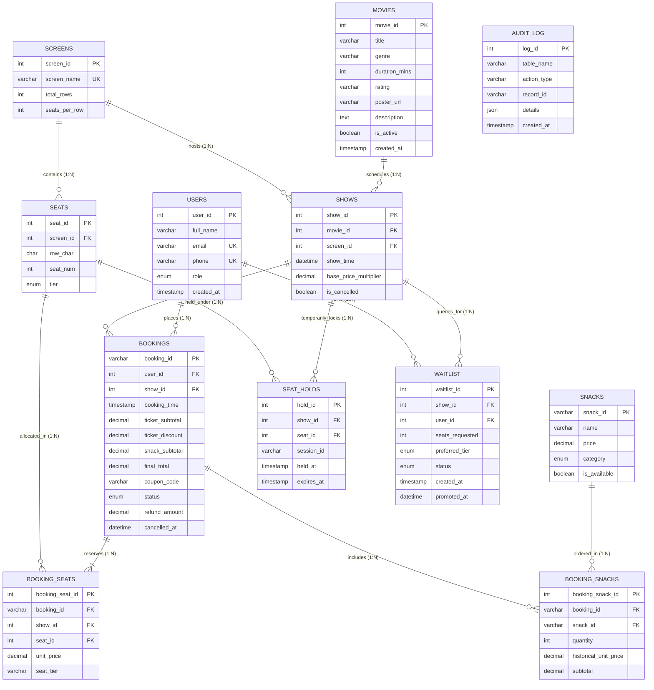

# 🐬 CineBook Web — Relational Database Management System (DBMS)

> **Comprehensive DBMS Architecture Document for Project Presentation & Faculty Viva Defense**  
> *Developed for 2nd-Year B.E. Computer Science & Engineering (Database Management Systems using MySQL 8)*

---

## 1. Executive DBMS Presentation Summary

The database layer of **CineBook Web** is implemented in **MySQL 8.0 (InnoDB)**. It is engineered with high-order relational integrity, strict 3NF normalization, ACID transaction guarantees, deterministic row-level locking, and native database objects (stored procedures, analytical views with window functions, triggers, and scheduled events).

---

## 2. Complete Entity-Relationship (ER) Architecture



---

## 3. Relational Schema Normalization (3NF Justification)

| Normal Form | Rule | CineBook Web Implementation |
|---|---|---|
| **1NF** | Atomic attribute values, no repeating groups | All multivalue attributes (multiple seats or concession items in a booking) are normalized into child tables (`booking_seats`, `booking_snacks`). Every table has an explicit primary key. |
| **2NF** | In 1NF and no partial dependencies on composite keys | All non-key attributes are fully dependent on the primary key. In intersection tables (`booking_seats`), surrogate primary keys (`booking_seat_id`) are paired with composite unique keys (`uq_show_seat`). |
| **3NF** | In 2NF and no transitive dependencies ($X \to Y \to Z$) | Screen dimensions (`total_rows`, `seats_per_row`) reside only in `screens`, never duplicated in `shows` or `seats`. Customer metadata lives only in `users`. |
| **Historical Audit Integrity** | Preservation of financial point-in-time facts | Concession items store `booking_snacks.historical_unit_price`. If the theater increases popcorn prices from Rs. 180 to Rs. 220, past customer audit rows remain strictly immutable. |

---

## 4. ACID Transactions & Concurrency Control

CineBook Web uses MySQL's default storage engine **InnoDB** running at the **`REPEATABLE READ`** isolation level:

### 1. Atomicity & Durability
Every reservation commits or rolls back as a single atomic unit using Spring's `@Transactional(rollbackFor = Exception.class)`. If payment or seat allocation fails halfway, all modifications to `bookings`, `booking_seats`, and `booking_snacks` roll back cleanly with zero orphaned records.

### 2. Double-Booking Prevention (Two-Tier Defense)
1. **Application-Level Row-Level Lock**:
   ```sql
   SELECT seat_id FROM seats WHERE seat_id IN (...) ORDER BY seat_id ASC FOR UPDATE;
   ```
   Under InnoDB, this performs a **Locking Read**, acquiring exclusive index record locks and preventing concurrent threads from reading uncommitted modifications.
2. **Database Engine Unique Constraint**:
   ```sql
   CONSTRAINT uq_show_seat UNIQUE (show_id, seat_id);
   ```
   Even if two threads reach the insert step concurrently, the B+Tree unique index physically rejects the second insertion with a duplicate key violation.

---

## 5. Advanced MySQL 8 Objects

### 1. Stored Procedures
- **`sp_release_expired_holds(OUT p_released_count INT)`**:
  Deletes expired temporary hold reservations:
  ```sql
  DELETE FROM seat_holds WHERE expires_at < NOW();
  SET p_released_count = ROW_COUNT();
  ```
- **`sp_cancel_booking(IN p_booking_id, OUT p_refund_amount, OUT p_result_code)`**:
  Executes transactional cancellation directly in the database engine:
  - Verifies booking exists and is currently `CONFIRMED`.
  - Calculates exact **80% refund**: `p_refund_amount = ROUND(v_final_total * 0.80, 2)`.
  - Sets `bookings.status = 'CANCELLED'`.
  - Deletes reserved seats from `booking_seats` (freeing seats immediately).
  - Promotes the first waitlisted customer (`waitlist.status = 'PROMOTED'`).

### 2. Analytical SQL Views with Window Functions
- **`v_show_occupancy`**: Computes real-time capacity, confirmed seats, active holds, and occupancy percentage per screening.
- **`v_movie_revenue_analytics`**: Aggregates ticket revenue, concession sales, cancellation refunds, and net realized revenue per movie.
- **`v_top_selling_snacks`**: Implements the SQL Window Function **`DENSE_RANK()`**:
  ```sql
  CREATE OR REPLACE VIEW v_top_selling_snacks AS
  SELECT 
      sn.snack_id,
      sn.name AS snack_name,
      sn.category,
      COALESCE(SUM(bs.quantity), 0) AS total_quantity_sold,
      COALESCE(SUM(bs.subtotal), 0.00) AS total_revenue_generated,
      DENSE_RANK() OVER (ORDER BY COALESCE(SUM(bs.subtotal), 0.00) DESC) AS revenue_rank
  FROM snacks sn
  LEFT JOIN booking_snacks bs ON sn.snack_id = bs.snack_id
  GROUP BY sn.snack_id, sn.name, sn.category, sn.price;
  ```

### 3. Database Triggers (Automated Audit Trail)
Database triggers log operations to `audit_log` with JSON snapshots:
- **`trg_after_booking_insert`**: Automatically creates a structured JSON record upon booking creation.
- **`trg_after_booking_cancel`**: Automatically records refund amount and timestamp when booking status changes to `CANCELLED`.

```sql
CREATE TRIGGER trg_after_booking_insert
AFTER INSERT ON bookings
FOR EACH ROW
BEGIN
    INSERT INTO audit_log (table_name, action_type, record_id, details)
    VALUES (
        'bookings',
        'INSERT',
        NEW.booking_id,
        JSON_OBJECT(
            'user_id', NEW.user_id,
            'show_id', NEW.show_id,
            'ticket_subtotal', NEW.ticket_subtotal,
            'final_total', NEW.final_total
        )
    );
END;
```

### 4. Complex Multi-Table Relational Joins (Admin Inspection Engine)
The Admin Portal's **Booked Seats Customer Roster** executes an optimized 4-table relational join providing full traceability from physical seats to confirmed reservations and customer profiles:

```sql
SELECT 
    bs.booking_seat_id,
    bs.booking_id,
    bs.show_id,
    bs.seat_id,
    s.row_char,
    s.seat_num,
    CONCAT(s.row_char, s.seat_num) AS seat_code,
    bs.seat_tier,
    bs.unit_price,
    b.booking_time,
    b.status AS booking_status,
    u.user_id,
    u.full_name AS customer_name,
    u.email AS customer_email,
    u.phone AS customer_phone
FROM booking_seats bs
JOIN bookings b ON bs.booking_id = b.booking_id
JOIN seats s ON bs.seat_id = s.seat_id
JOIN users u ON b.user_id = u.user_id
WHERE bs.show_id = ? AND b.status = 'CONFIRMED'
ORDER BY s.row_char ASC, s.seat_num ASC;
```

---

## 6. Indexing Strategy & Performance Analysis

| Index Name | Table & Columns | Performance Benefit ($O(\log N)$) |
|---|---|---|
| `idx_shows_movie_time` | `shows(movie_id, show_time)` | Accelerates user browsing by filtering screenings by movie in chronological order. |
| `idx_seat_holds_expiry`| `seat_holds(expires_at)` | Speeds up the 15-second hold cleanup sweep (`WHERE expires_at < NOW()`). |
| `idx_bookings_show_status` | `bookings(show_id, status)` | Powers real-time occupancy calculations and seat availability lookups. |
| `idx_bookings_user_time` | `bookings(user_id, booking_time DESC)` | Accelerates ticket history lookup in "My Tickets" portal. |
| `uq_show_seat` | `booking_seats(show_id, seat_id)` | Enforces physical impossibility of double-booking at the B+Tree index level. |

---

## 7. Faculty Viva Defense Q&A for DBMS

### Q1: What is the difference between `RANK()` and `DENSE_RANK()` in your top-selling snacks view?
**Answer:** `RANK()` assigns identical rank to tied values but leaves gaps in subsequent ranks (e.g., 1, 2, 2, 4). `DENSE_RANK()` assigns identical rank to tied values without leaving gaps (e.g., 1, 2, 2, 3), making it the mathematically superior choice for executive product sales ranking.

### Q2: Why are snacks preserved in `booking_snacks` when a booking is cancelled?
**Answer:** Financial auditability. When a booking is cancelled, seats in `booking_seats` are deleted to allow other customers to reserve them, but concession records in `booking_snacks` are preserved so total inventory movements and revenue reconciliations can be audited accurately.

### Q3: Why use database triggers instead of logging inside Java code?
**Answer:** Triggers execute at the database engine level. If an administrator runs an SQL query directly via MySQL Workbench, DBeaver, or command line, the audit row is still guaranteed to be written, preventing unlogged administrative modifications.

