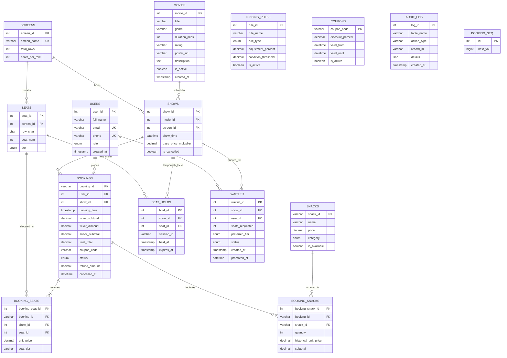

# CineBook Web — Entity-Relationship (ER) Architecture

## 1. Relational Entity-Relationship Diagram (Mermaid)

---

## 2. Relational Schema Normalization (3NF Justification)

1. **First Normal Form (1NF)**:
   - Every column contains atomic values. All multivalue attributes (such as seats in a booking or concession orders) are decoupled into dedicated child tables (`booking_seats`, `booking_snacks`).
   - Every table possesses an explicit primary key (`PK`).

2. **Second Normal Form (2NF)**:
   - All tables are in 1NF and every non-key attribute is fully functionally dependent on the entire primary key.
   - In composite scenarios (`booking_seats`), foreign key references (`booking_id`, `show_id`, `seat_id`) are uniquely keyed via surrogate `booking_seat_id` and reinforced by composite unique keys (`uq_show_seat`).

3. **Third Normal Form (3NF)**:
   - No transitive dependencies exist.
   - Screen dimensions (`total_rows`, `seats_per_row`) reside strictly in `screens`, not duplicated inside `shows` or `seats`.
   - Movie metadata (`genre`, `duration_mins`) resides strictly in `movies`, not in `shows`.
   - Customer credentials reside strictly in `users`.
   - Historical pricing integrity: `booking_snacks.historical_unit_price` preserves historical transactional snapshot independent of menu mutations in `snacks.price`.

---

## 3. Database Indexes & Justifications

| Index Name | Table & Columns | Academic / Performance Justification |
|---|---|---|
| `idx_shows_movie_time` | `shows(movie_id, show_time)` | Optimizes user navigation on the movie details page, filtering screenings by movie ID in chronological order ($O(\log N)$ range scan). |
| `idx_seat_holds_expiry` | `seat_holds(expires_at)` | Accelerates the high-frequency 15-second Spring cleanup job and MySQL 1-minute event sweep (`WHERE expires_at < NOW()`). |
| `idx_bookings_show_status` | `bookings(show_id, status)` | Crucial for real-time occupancy computations and seat map availability checks (`WHERE show_id = ? AND status = 'CONFIRMED'`). |
| `idx_bookings_user_time` | `bookings(user_id, booking_time DESC)` | Accelerates customer reservation retrieval in the "My Tickets" portal. |
| `uq_show_seat` | `booking_seats(show_id, seat_id)` | Enforces physical impossibility of double-booking the same seat for a single screening at the relational database engine level. |

