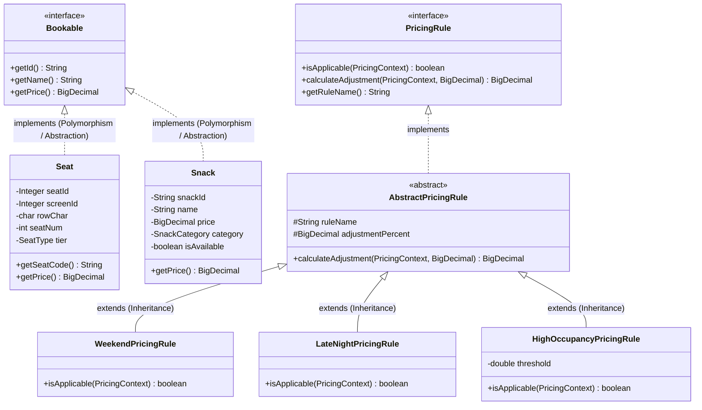

# ☕ CineBook Web — Object-Oriented Programming (OOP) in Java 21

> **Comprehensive OOP Architecture Document for Project Presentation & Faculty Viva Defense**  
> *Developed for 2nd-Year B.E. Computer Science & Engineering (Object-Oriented Programming using Java)*

---

## 1. Executive OOP Presentation Summary

**CineBook Web** demonstrates production-grade Object-Oriented Software Engineering using modern **Java 21 LTS** and **Spring Boot 3**. 

Rather than treating Java as procedural scripting inside controllers, CineBook Web implements clean domain modeling, strong type safety, polymorphic interfaces, behavior-rich enums, immutable value objects, custom exception hierarchies, and industry-standard design patterns.

---

## 2. The Four Pillars of OOP in CineBook Web



---

### 🏛️ Pillar 1: Abstraction
**Definition:** Hiding internal structural implementation details and exposing only essential functional contracts through interfaces and abstract classes.

**Implementations in CineBook Web:**
1. **`Bookable` Interface**:
   ```java
   public interface Bookable {
       String getId();
       String getName();
       BigDecimal getPrice();
   }
   ```
   Both `Seat` (auditorium hardware) and `Snack` (food concessions) implement `Bookable`. The checkout engine treats tickets and snacks as uniform commercial inventory without needing to know row geometry or culinary shelf-life.
2. **`PricingRule` Interface**:
   Defines dynamic surcharge contracts (`isApplicable(context)` and `calculateAdjustment(context, baseAmount)`).
3. **`SeatRecommendationStrategy` Interface**:
   Decouples the seat recommendation engine from the controller layer, allowing algorithmic swapping at runtime.
4. **Data Access Layer (`DAO` Interfaces)**:
   `MovieDao`, `ShowDao`, `SeatDao`, `BookingDao` abstract relational SQL persistence, queries, and locks completely away from business services.

---

### 🛡️ Pillar 2: Encapsulation & Immutability
**Definition:** Bundling data and methods operating on that data within a single unit while restricting direct outside access to internal state.

**Implementations in CineBook Web:**
1. **Domain Model Data Hiding**:
   Fields in entities (`Booking`, `Seat`, `Show`, `User`) are strictly declared `private`. Access is regulated via validated getters and business-rule mutators.
   ```java
   public class Seat implements Bookable {
       private Integer seatId;
       private char rowChar;
       private int seatNum;
       private SeatType tier;

       public void setRowChar(char rowChar) {
           this.rowChar = Character.toUpperCase(rowChar);
           this.tier = SeatType.forRow(this.rowChar); // Invariant maintained internally
       }
   }
   ```
2. **Immutable Value Objects (Defensive Copying)**:
   Financial calculations in `PriceBreakdown` must never be altered after evaluation. It uses `final` fields, no setter methods, and returns unmodifiable defensive copies:
   ```java
   public final class PriceBreakdown {
       private final BigDecimal baseTicketTotal;
       private final Map<String, BigDecimal> ruleAdjustments;

       public Map<String, BigDecimal> getRuleAdjustments() {
           return Collections.unmodifiableMap(ruleAdjustments); // Defensive copy
       }
   }
   ```

---

### 🧬 Pillar 3: Inheritance
**Definition:** Mechanism where a subclass derives attributes and behaviors from a generalized parent class, promoting code reuse.

**Implementations in CineBook Web:**
`AbstractPricingRule` captures shared percentage calculation logic to avoid code duplication across dynamic pricing rules:

```java
public abstract class AbstractPricingRule implements PricingRule {
    protected final String ruleName;
    protected final BigDecimal adjustmentPercent; // e.g. +0.15 for +15%

    public AbstractPricingRule(String ruleName, BigDecimal adjustmentPercent) {
        this.ruleName = ruleName;
        this.adjustmentPercent = adjustmentPercent;
    }

    @Override
    public BigDecimal calculateAdjustment(PricingContext ctx, BigDecimal baseAmount) {
        return baseAmount.multiply(adjustmentPercent).setScale(2, RoundingMode.HALF_UP);
    }
}
```
Concrete subclasses (`WeekendPricingRule`, `LateNightPricingRule`, `HighOccupancyPricingRule`) inherit the calculation and only implement their unique business condition (`isApplicable`).

---

### 🔀 Pillar 4: Polymorphism
**Definition:** The ability of an object or method invocation to take on many forms depending on the runtime instance (Dynamic Method Dispatch).

**Implementations in CineBook Web:**
1. **Dynamic Method Dispatch in `PricingEngine`**:
   The engine iterates over an injected collection of `List<PricingRule>`:
   ```java
   for (PricingRule rule : rules) {
       if (rule.isApplicable(context)) {
           BigDecimal adjustment = rule.calculateAdjustment(context, baseTicketTotal);
           // Dispatches polymorphically to WeekendPricingRule or LateNightPricingRule
       }
   }
   ```
2. **Runtime Algorithm Swapping in `RecommendationService`**:
   The controller selects between `CenterContiguousStrategy` and `TierOptimizedContiguousStrategy` via a single polymorphic interface call:
   ```java
   SeatRecommendationStrategy strategy = getStrategy(request.getStrategyType());
   List<Seat> recommended = strategy.recommendSeats(showId, count, preferredTier);
   ```

---

## 3. Design Patterns Applied

| Pattern | Implementation in CineBook Web | Benefit / Purpose |
|---|---|---|
| **Strategy Pattern** | `SeatRecommendationStrategy` (`CenterContiguousStrategy`, `TierOptimizedStrategy`) | Enables hot-swapping seat selection algorithms based on customer criteria. |
| **DAO Pattern** | `MovieDao`, `ShowDao`, `SeatDao`, `BookingDao`, `AnalyticsDao` using Spring `JdbcTemplate` | Completely decouples raw SQL, analytical views, and transactional locks from business services. |
| **Chain of Responsibility** | `PricingEngine` chaining sequential surcharge / discount rules | Allows adding new dynamic pricing rules without modifying existing logic (Open/Closed Principle). |
| **Factory Pattern** | `BookingDao.getNextBookingSequence()` | Thread-safe generation of formatted business keys (`CB1001`, `CB1002`). |
| **Singleton Pattern** | Managed by Spring IoC container (`@Service`, `@Repository`, `@RestController`) | Ensures thread-safe, stateless shared service singletons across requests. |
| **Value Object Pattern**| `PriceBreakdown`, `SeatCoordinate` | Guarantees audit integrity and thread-safety through immutability. |
| **Lifecycle Runner Pattern**| `MovieDataInitializer` (`CommandLineRunner`) | Idempotent automatic synchronization of the 6-film catalog and dynamic screening schedules on application boot. |

---

## 4. Behavior-Rich Java Enums

In CineBook Web, seat pricing is strictly defined in Java domain code rather than hardcoded in database columns. The `SeatType` enum encapsulates domain rules, base prices, and factory logic:

```java
public enum SeatType {
    REGULAR(new BigDecimal("150.00"), "Standard cinema seating in front rows"),
    PREMIUM(new BigDecimal("250.00"), "Optimum viewing distance in middle rows"),
    VIP(new BigDecimal("400.00"), "Luxury motorized recliner with leg rest");

    private final BigDecimal basePrice;
    private final String description;

    SeatType(BigDecimal basePrice, String description) {
        this.basePrice = basePrice;
        this.description = description;
    }

    public BigDecimal getBasePrice() { return basePrice; }

    public static SeatType forRow(char rowChar) {
        char upper = Character.toUpperCase(rowChar);
        if (upper == 'A' || upper == 'B') return REGULAR;
        if (upper == 'C' || upper == 'D') return PREMIUM;
        if (upper == 'E') return VIP;
        throw new IllegalArgumentException("Invalid auditorium row: " + rowChar);
    }
}
```

---

## 5. Custom Exception Hierarchy & Centralized Exception Handling

CineBook Web avoids generic runtime errors by defining clean, domain-specific exceptions:

```
                  RuntimeException
                          │
       ┌──────────────────┼──────────────────┐
       ▼                  ▼                  ▼
SeatUnavailableException SeatHeldException InvalidCouponException
       │                  │
DuplicateCancellationException BookingNotFoundException
```

A centralized `@RestControllerAdvice` (`GlobalExceptionHandler`) intercepts domain exceptions and converts them to uniform, client-friendly HTTP responses:

```java
@RestControllerAdvice
public class GlobalExceptionHandler {

    @ExceptionHandler(SeatUnavailableException.class)
    public ResponseEntity<ApiResponse<Void>> handleSeatUnavailable(SeatUnavailableException ex) {
        return ResponseEntity.status(HttpStatus.CONFLICT)
            .body(ApiResponse.error(ex.getMessage())); // HTTP 409
    }

    @ExceptionHandler(SeatHeldException.class)
    public ResponseEntity<ApiResponse<Void>> handleSeatHeld(SeatHeldException ex) {
        return ResponseEntity.status(HttpStatus.LOCKED)
            .body(ApiResponse.error(ex.getMessage())); // HTTP 423
    }
}
```

---

## 6. Concurrency, Multithreading & Deadlock Prevention

### 1. Eliminating Circular Wait (Coffman Condition #4)
When multiple threads attempt to book overlapping seats simultaneously, a deadlock could occur if Thread 1 locks Seat 5 then Seat 6, while Thread 2 locks Seat 6 then Seat 5.

CineBook Web **deterministically sorts all seat IDs ascending** before acquiring locks:
```java
List<Integer> sortedSeatIds = new ArrayList<>(request.getSeatIds());
Collections.sort(sortedSeatIds); // Guarantees global monotonic lock acquisition
bookingDao.lockSeatsForUpdate(showId, sortedSeatIds);
```

### 2. Spring Background Scheduler Thread
A background worker running on a dedicated thread pool sweeps expired 5-minute seat holds every 15 seconds:
```java
@Scheduled(fixedRate = 15000)
public void evictExpiredSeatHolds() {
    int released = seatHoldDao.releaseExpiredHolds();
    if (released > 0) {
        log.info("Evicted {} expired seat holds", released);
    }
}
```

---

## 7. Faculty Viva Defense Q&A for Java / OOP

### Q1: Why not use Hibernate or Spring Data JPA?
**Answer:** In academic and high-concurrency systems, ORM frameworks introduce hidden queries, lazy-loading overhead, and non-deterministic lock acquisition orders. Using pure JDBC via `JdbcTemplate` allows explicit control over transaction boundaries (`REPEATABLE READ`), deterministic row locks (`ORDER BY seat_id ASC FOR UPDATE`), and native stored procedure invocations.

### Q2: How does CineBook Web achieve Open/Closed Principle (OCP)?
**Answer:** The `PricingEngine` accepts `List<PricingRule>`. If the cinema introduces a new pricing policy (e.g. *Student Tuesday Discount*), we simply create a new class implementing `PricingRule`. The engine automatically picks it up via Spring dependency injection without changing a single line of existing pricing code.

### Q3: What is the difference between Method Overloading and Method Overriding in CineBook?
**Answer:**
- **Overloading (Static Polymorphism):** `ApiResponse.success(data)` and `ApiResponse.success(data, message)` share the same name but differ in parameter lists at compile time.
- **Overriding (Dynamic Polymorphism):** `WeekendPricingRule.isApplicable()` overrides the abstract contract of `PricingRule.isApplicable()` at runtime via dynamic method dispatch.

